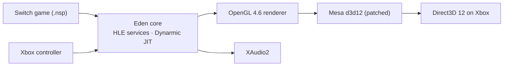

<!--
SPDX-FileCopyrightText: Copyright 2025 Eden Emulator Project
SPDX-FileCopyrightText: 2018 yuzu Emulator Project
SPDX-License-Identifier: GPL-3.0-or-later
-->

<h1 align="center">
   
  
   
  <b>Eglantine</b>
   
</h1>

<h4 align="center"><b>Eglantine</b> is a free and opensource (FOSS) Switch 2 emulator, derived from Eden, Yuzu and Sudachi - started by developer Camille LaVey.
It's written in C++ with portability in mind, with builds for Windows, Linux and macOS
</h4>

    </a>
    
  

> [!NOTE]
> **This is an unofficial fork of Eglantine maintained by Zortos.** It carries fixes that are not in the upstream [Eglantine](https://github.com/Djihads80/Eglantine) repository. Please report problems with this build here, not to the upstream developers.

## About this fork

My priority is getting every game to boot and run. Performance comes second.

Changes in this fork compared to upstream:

- **Memory leak fixed.** Memory use stays around 4-5 GB instead of climbing past 20 GB.
- **More games boot**, including Welcome Tour.
- **Games run at normal speed.** The slowdown is gone.
- **Big performance boost.** Most games run at 60 FPS.
- **Texture fixes** in several games.
- **Color fix** for the HDR setting in docked mode.
- **Graphics fixes.** Video codec fixes are coming soon.

  <a href="#about-this-fork">About this fork</a> |
  <a href="#compatibility">Compatibility</a> |
  <a href="#development">Development</a> |
  <a href="#building">Building</a> |
  <a href="#download">Download</a> |
  <a href="#support">Support</a> |
  <a href="#license">License</a>

## Compatibility

The emulator is capable of running Mario Kart World at decent/full speed depending on specs and configurations, and Splatoon Raiders at variable performances

## Where it stands

## Development
For development discussions, please join us on [Discord](https://discord.gg/jCCZ58VExk)

If you would like to contribute, we are open to new developers and pull requests. Please ensure that your work is of a high standard and properly documented. You can also contact any of the developers on Discord or Stoat to learn more about the current state of the emulator.

## How it works

- `src/eden_uwp/`: the Xbox frontend. It boots the game, owns the window and the controller, and
  writes `eden_uwp_diag.txt` with frame pacing, memory and stall attribution.
- `tools/nxbox/patch_mesa_uwp.py`: the Mesa patches, applied to a pinned
  [aerisarn/mesa-uwp](https://github.com/aerisarn/mesa-uwp) in CI.
- `tools/shader-share/`: a small server that keeps the largest valid shader cache per title.

## Trying it

You need an Xbox Series X|S in **Developer Mode** and your own dumps:

1. Install a package from the
   [package workflow](https://github.com/NspxMiguel/NXbox/actions/workflows/package-nxbox.yml)
   through the Device Portal.
2. Put `prod.keys` and `title.keys` in the app's `LocalState\eden\keys`.
3. Put your games (`.nsp`, `.nsz` or `.xci`) in `LocalState\games`, or on a USB drive in
   `NXbox\games` (the console's internal developer storage is small, a few GB). `.nsz` files are
   converted on the console the first time the library sees them.
4. Launch NXbox from the dashboard and pick the game in the library.

Builds of this fork are on the [releases page](https://github.com/zortos293/eglantine/releases).

Official upstream releases are [here](https://github.com/Djihads80/Eglantine/releases).

## Support

We currently do not take in any donations for the time being

If you would prefer to support us in a different way, please join our [Discord](https://discord.gg/jCCZ58VExk)

## License

Eglantine is licensed under the GPLv3 (or any later version). Refer to the [LICENSE.txt](https://github.com/Djihads80/Eglantine/blob/nx2/LICENSE.txt) file.
